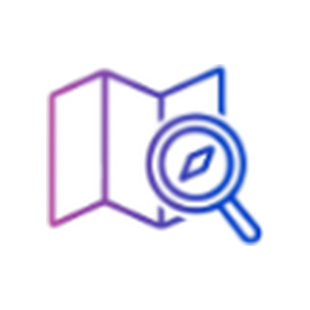

<div align="center">



# CadêWeb

### Prospecção inteligente de clientes e negócios locais: do Google Maps e Instagram direto pro seu CRM

Encontre pequenos negócios locais **sem site ou com presença digital fraca**, receba a estratégia
de abordagem personalizada e mensagens prontas por IA, use scripts validados para WhatsApp e acompanhe tudo
num Kanban visual completo com Cockpit diário — do primeiro contato ao fechamento.


</div>

---

## 📋 Índice

- [O que é](#-o-que-é)
- [Funcionalidades em Destaque](#-funcionalidades-em-destaque)
- [Como Começar (Passo a Passo)](#-como-começar-passo-a-passo)
- [Uso no Dia a Dia](#-uso-no-dia-a-dia)
- [Arquitetura & Stack](#-arquitetura--stack)
- [Estrutura do Projeto](#-estrutura-do-projeto)
- [Segurança & Privacidade](#-segurança--privacidade)
- [Perguntas Frequentes](#-perguntas-frequentes)
- [Uso](#-uso)

---

## 🎯 O que é

**CadêWeb** é uma estação de trabalho e CRM especializado na captação ativa de clientes para quem vende desenvolvimento web, landing pages, automações e soluções digitais para negócios locais.

Ele soluciona o funil de prospecção de ponta a ponta:
1. **Varredura Ativa:** Encontra empresas no **Google Maps** (por nicho + cidade ou via mapa interativo com raio e pinos) e comentários em posts do **Instagram**.
2. **Raio-X de Presença Digital:** Analisa o site de cada empresa automaticamente, separando negócios que **não possuem site** daqueles com sites lentos, inseguros (sem HTTPS) ou não responsivos para celular.
3. **Cockpit Diário & Kanban de Vendas:** Organiza os leads em um pipeline ágil de 6 estágios (`Novo`, `Contatado`, `Respondeu`, `Reunião`, `Fechou`, `Recusou`).
4. **Abordagem com IA & Scripts Prontos:** Gera copys personalizadas e disponibiliza modais com os 5 melhores frameworks de abordagem rápida via WhatsApp (Elogio + Gancho, Solução Direta, Pergunta Consultiva, etc.).
5. **Diagnóstico Executivo em PDF:** Gera laudo técnico com notas do Google PageSpeed para impressionar o cliente no fechamento.

> 💡 **Privacidade Total:** O CadêWeb roda 100% na sua própria máquina local. Sem mensalidades abusivas por crédito de lead, com cofre seguro de credenciais pelo Windows Credential Manager.

---

## ✨ Funcionalidades em Destaque

- 🗺️ **Radar Google Maps com Sonar:** Busca visual e interativa com feedback em tempo real e cálculo geográfico de proximidade.
- 📊 **CRM Kanban 6 Etapas:** Arraste e solte seus leads entre colunas com cálculo instantâneo de taxas de conversão.
- ⚡ **Cockpit "Hoje":** Bloco de foco diário que destaca os follow-ups agendados, reuniões pendentes e mensagens para responder.
- 💬 **Scripts WhatsApp em 1 Clique:** Modal inteligente com 5 estratégias de primeiro contato pré-configuradas.
- 🤖 **IA com Fallback Triplo:** Geração de mensagens alimentada por Gemini, Groq ou NVIDIA Build — se um provedor bater limite diário, o CadêWeb alterna suavemente para o próximo sem travar.
- 📑 **Laudo Diagnóstico em PDF:** Crie um documento formal com selos visuais de auditoria e métricas reais de velocidade do site do lead.

---

## 🚀 Como Começar (Passo a Passo)

### Pré-requisitos
- [Python 3.11+](https://www.python.org/)
- [Node.js 20+](https://nodejs.org/)
- Sistema operacional Windows

### 1. Clonar ou Baixar o Repositório

```powershell
git clone <URL_DO_REPOSITORIO>
cd CadêWeb
```

### 2. Configurar o Backend

```powershell
cd backend
py -m pip install -r requirements.txt
copy .env.example .env
```

Obtenha uma chave gratuita de IA (usada nas abordagens e enriquecimento):
- **Google Gemini:** https://aistudio.google.com/apikey
- **Groq:** https://console.groq.com/keys
- **NVIDIA Build:** https://build.nvidia.com

> Cole a chave no arquivo `backend/.env` ou salve diretamente na interface do CadêWeb em **Configurações** (onde ela fica criptografada no cofre do Windows).

### 3. Binário do Scraper do Google Maps

Para habilitar a extração do Google Maps:
1. Baixe o executável para Windows na [página oficial de releases](https://github.com/gosom/google-maps-scraper/releases/latest).
2. Renomeie o arquivo baixado para `google-maps-scraper.exe`.
3. Mova-o para dentro da pasta `backend/` (ao lado de `app.py`).

### 4. Configurar o Frontend

```powershell
cd ../frontend
npm install
```

### 5. Iniciar o Aplicativo

Basta dar duplo clique em `iniciar.bat` na raiz do projeto ou executar no terminal:

```powershell
cd ..
.\iniciar.bat
```

O CadêWeb iniciará os serviços e abrirá seu navegador padrão em: **http://localhost:5173** 🎉

---

## 🛠️ Uso no Dia a Dia

### Prospecção no Google Maps
1. Vá na aba **Google Maps** e clique em **"Nova busca"**.
2. Escolha **Por Texto** (ex.: `Advogados em Curitiba`, `Dentistas em Florianópolis`) ou **Por Mapa** (solte pinos nas regiões metropolitanas e defina o raio em km).
3. O CadêWeb faz o rastreamento, audita o domínio e descarta automaticamente quem já possui um portal moderno e consolidado.

### Gestão no Kanban e Abordagem
1. Acesse o **Kanban** para ver os leads qualificados ordenados por prioridade e score.
2. Clique no ícone de WhatsApp em qualquer card para abrir o **Modal de Primeiro Contato**.
3. Escolha o framework desejado (ex.: *Elogio + Gancho*, *Solução Direta*), faça os ajustes finos e abra direto a conversa com a mensagem preenchida.
4. Mova o lead para **Contatado**, depois **Respondeu** e agende a **Reunião**.

---

## 🧱 Arquitetura & Stack

- **Backend:** Python 3.11+ · Flask (Blueprints REST) · SQLite (Modo WAL) · Waitress WSGI
- **Frontend:** React 19 · TypeScript · Vite 8 · Tailwind CSS 4 · Radix UI · Lucide Icons
- **Desktop:** Electron (Shell nativo opcional com multi-janela e sidecar integrado)
- **Cofre:** Keyring com DPAPI do Windows
- **Testes:** Suíte Pytest com 375 testes automatizados

---

## 📁 Estrutura do Projeto

```
CadêWeb/
├── iniciar.bat              # Script de subida automática (backend + frontend)
├── backend/
│   ├── app.py                # Servidor Flask e registro de rotas
│   ├── rotas_*.py            # Blueprints (leads, instagram, analytics, configs)
│   ├── cadeweb.spec          # Configuração de build PyInstaller
│   ├── cadeweb.ico           # Ícone nativo da aplicação
│   ├── db.py                 # Conexão SQLite e cofre de credenciais
│   ├── processar.py          # Pipeline de validação e auditoria web
│   ├── jobs.py               # Fila de tarefas em segundo plano
│   └── tests/                # 375 testes automatizados (pytest)
├── frontend/
│   ├── public/
│   │   ├── cadeweb-icon.png  # Identidade visual oficial
│   │   └── favicon.ico       # Favicon
│   └── src/
│       ├── components/       # Componentes React (Kanban, Cockpit, Radar, Modais)
│       ├── pages/            # Páginas da aplicação
│       └── lib/              # Constantes e regras de negócio
├── desktop/                  # Shell Electron para empacotamento Windows (.exe)
└── instalador/               # Script Inno Setup (cadeweb.iss)
```

---

## 🔒 Segurança & Privacidade

- **Sem Nuvem de Terceiros:** Todos os seus leads, anotações e status residem única e exclusivamente no seu disco local (`leads.db`).
- **Proteção no Git:** O `.gitignore` do repositório já vem totalmente configurado para impedir o commit acidental de chaves de API (`.env`), bancos locais (`*.db`), logs e binários.

---

## 📄 Uso

Sinta-se à vontade para utilizar, modificar e comercializar seus serviços digitais gerados com a ferramenta!
